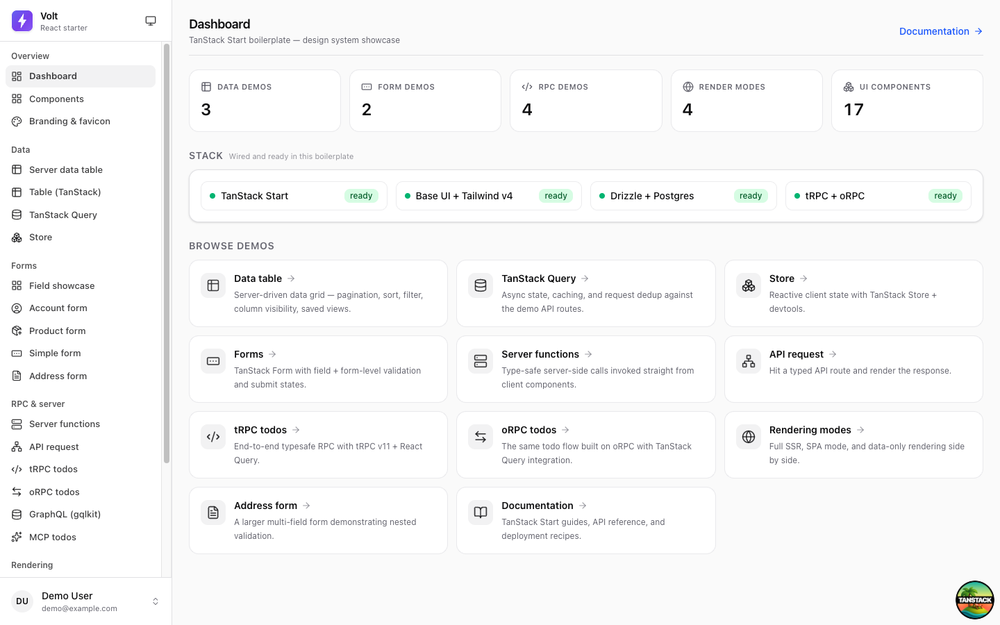
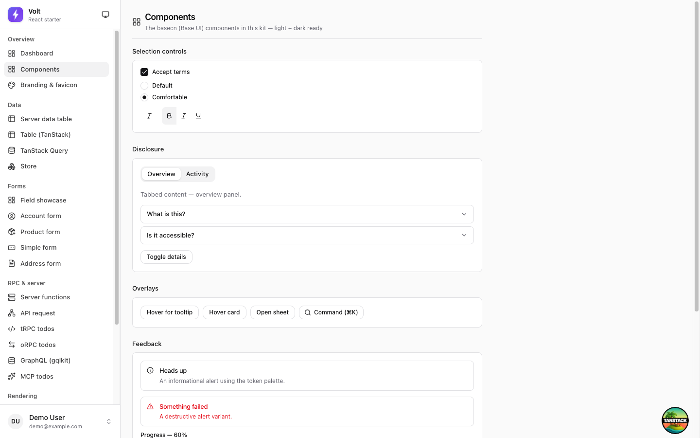
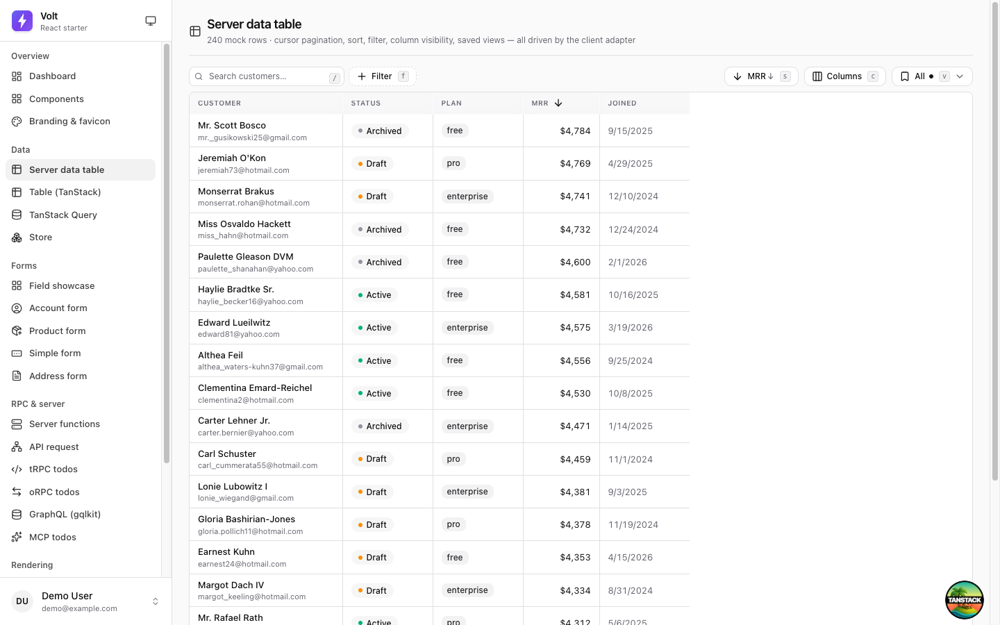
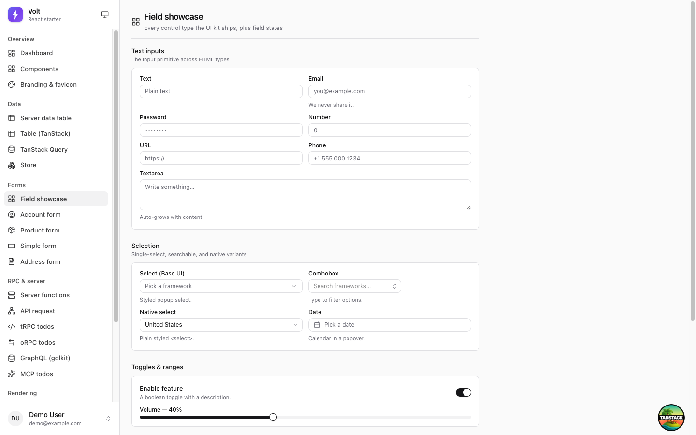

# Volt framework docs

These are the **Volt framework docs** — reference material for the boilerplate itself (its integrations, conventions, and deployment). They live under `volt/docs/` on purpose: when you build your real app on top of Volt, keep your own app docs elsewhere (e.g. `docs/`), and this folder stays as the Volt reference you can update or remove independently.

Setup and the dev workflow live in [`../CONTRIBUTING.md`](../CONTRIBUTING.md). The product overview is [`../README.md`](../README.md).

## Guides

- [DRIZZLE.md](DRIZZLE.md) — the Drizzle ORM module (schema, migrations, env).
- [GQLKIT.md](GQLKIT.md) — the typed GraphQL SDK (generation, clients, scalar bindings).
- [SENTRY.md](SENTRY.md) — Sentry client + server instrumentation.
- [SHADCN.md](SHADCN.md) — adding/using basecn (Base UI) components.
- [SPA_MODE.md](SPA_MODE.md) — SSR vs SPA mode notes.
- [DEPLOYMENT_PLAN.md](DEPLOYMENT_PLAN.md) — container + CI/CD deployment plan.
- [incidents/](incidents/) — postmortems for notable build/runtime issues.

## Screenshots

The UI these docs describe, captured from the running demo (`https://app.localhost`).

| | |
|---|---|
|  |  |
| The dashboard shell (`/demo`) | The basecn component gallery (`/demo/components`) |
|  |  |
| The `ServerDataTable` (`/demo/server-table`) | Every field type (`/demo/form/kitchen-sink`) |

> Regenerate anytime: start the app (`task dev:guard`) then run **`task screenshots`** (drives Chrome via CDP, captures these pages at 1440×900 into `volt/screenshots/`).
